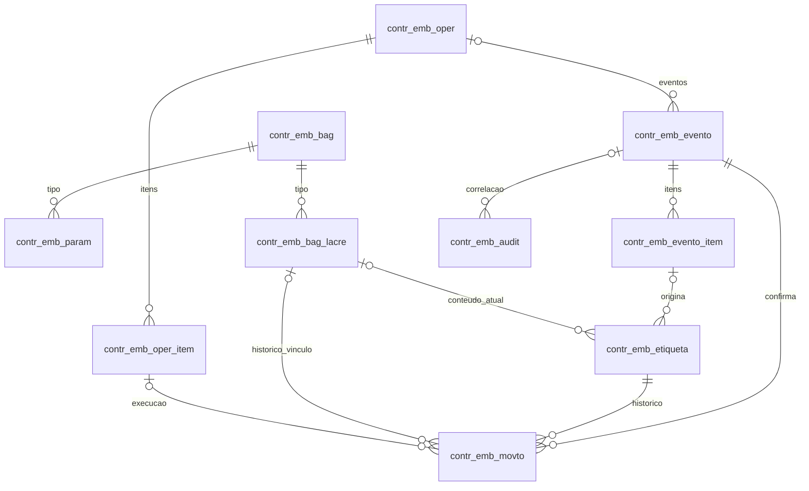

# Modelo de dados simplificado — Controle de Embalagens

**Versão:** 1.7 · **Data:** 09/09/2026 · **Status:** estrutura física e schema holder implantados e verificados em TESTE

Em 09/09/2026, as 10 tabelas, 10 sequências, 47 índices lógicos e 10 índices de `PROGRESS_RECID` foram criados com sucesso em `BPTESTE/EMS2ESP`. As colunas físicas adicionais `U##` atendem aos textos indexados pelo DataServer e não alteram os 219 campos lógicos do modelo. As dez tabelas foram carregadas e verificadas no schema holder `shmgesp`; em 10/09/2026, as dez sequências e seus metadados físicos também foram confirmados em nova sessão ABL.

Esta revisão reduz o modelo para 10 tabelas. `contr_emb_etiqueta` reúne a identidade permanente e seu estado individual atual, enquanto `contr_emb_movto` preserva os fatos imutáveis que explicam cada alteração. A fusão elimina a relação obrigatória 1:1 com `contr_emb_saldo`, seis campos duplicados e uma atualização entre duas tabelas sem perder histórico. Também remove `contr_emb_oper.id-evento-inclusao`, evitando dependência circular; eventos se relacionam à operação por `contr_emb_evento.id-operacao`. O modelo v1.6 foi preservado em `docs/modelo-dados/contr_emb_v1_6.json`.

## 1. Decisão de simplificação

O projeto continua usando as tabelas padrão do Datasul como autoridade para documentos fiscais, itens, lotes, movimentos e saldo consolidado. As tabelas específicas guardam somente a parametrização, a identidade individual, o estado atual, os fatos de rastreabilidade e as informações mínimas necessárias para repetir e auditar os processos.

| Estrutura removida ou incorporada | Destino no modelo corrente v1.7 |
|---|---|
| `contr_emb_docto`, `contr_emb_docto_ref`, `contr_emb_docto_item` | Documento permanece no Datasul/ANFE; `contr_emb_evento` guarda identidade e fotografia mínima; seus itens ficam em `contr_emb_evento_item`. |
| `contr_emb_geracao` | Cálculo, parâmetro congelado, quantidade de etiquetas e resíduo ficam em `contr_emb_evento_item`. |
| `contr_emb_agrup`, `contr_emb_bag_item` | A consolidação fiscal fica no item do evento; o estado individual e o vínculo atual com Bag ficam em `contr_emb_etiqueta`; inclusão/retirada de Bag é fato em `contr_emb_movto`. |
| `contr_emb_saldo` da v1.6 | Identidade e estado atual ficam juntos em `contr_emb_etiqueta`; fatos continuam em `contr_emb_movto`. |
| `contr_emb_oper_baixa` | Linhas `BAIXA` em `contr_emb_oper_item` apontam para a linha de origem e distinguem dimensão física/fiscal. |
| `contr_emb_fila` | Não entra no núcleo sem contrato assíncrono concreto. Se necessário, será acrescentada como outbox sem remodelar as entidades centrais. |

Essa concentração preserva a separação entre estado atual e histórico sem exigir uma tabela 1:1. `contr_emb_etiqueta` identifica e mantém o estado individual corrente; `contr_emb_movto` explica cada alteração. `contr_emb_evento_item` concentra a quantidade fiscal que será rateada; `saldo-estoq` continua somente como saldo consolidado padrão do Datasul.

## 2. Tabelas resultantes

| Tabela | Responsabilidade |
|---|---|
| `contr_emb_bag` | Cadastro global de tipos de embalagem, nome já definido pelo responsável técnico. |
| `contr_emb_param` | Parametrização dos itens controlados por estabelecimento. |
| `contr_emb_evento` | Evento idempotente e fotografia mínima do documento/ação que dispara o controle. |
| `contr_emb_evento_item` | Itens/lotes do evento e memória do cálculo de geração, inclusive resultado zero. |
| `contr_emb_etiqueta` | Embalagens individualizadas e, durante a transição, saldos agregados anteriores ao controle. |
| `contr_emb_movto` | Histórico imutável de quantidades, situação e localização de cada etiqueta. |
| `contr_emb_bag_lacre` | Ocorrência operacional da Bag, seu tipo, lacre e destino. |
| `contr_emb_oper` | Cabeçalho das operações de transferência, campo, empréstimo, devolução e demais fluxos previstos. |
| `contr_emb_oper_item` | Itens e quantidades solicitados/executados em uma operação. |
| `contr_emb_audit` | Histórico de alterações cadastrais e operacionais, inclusive exclusões permitidas. |

## 3. Relações principais

Os documentos padrão são referenciados por suas identidades confirmadas no evento, sem FK física para tabelas do ERP. Relacionamentos específicos são requisitos lógicos e transacionais do serviço ABL; não significam exclusão em cascata.

## 4. Convenções

- Campos conhecidos do ERP usam `LIKE tabela.campo`. Os campos usados pela estrutura v1.7 foram materializados e conferidos no schema holder de TESTE em 09/09/2026; qualquer novo campo `LIKE` continua exigindo conferência no dicionário real, pois o nome encontrado em fonte não comprova formato, banco lógico ou chave.
- `INTEGER` é usado em ABL para identidades e versões. Na fronteira REST, identidades técnicas e cursores de ID são serializados como texto decimal; versões, sequências funcionais e contagens permanecem números inteiros. Sequências nativas, sem ciclo e sob uma autoridade única, alocam os IDs. Lacunas são aceitas; não usar `MAX + 1` ou ROWID.
- `DECIMAL(4 casas)` é escala de negócio. Valores com precisão maior não serão arredondados silenciosamente. Conversão usa fator com oito casas e valida resultado na unidade de estoque.
- `CHARACTER(n)` tem limite validado na aplicação e refletido no DDL Oracle; não presumir que `FORMAT X(n)` sozinho limite o armazenamento. Conteúdos técnicos usam `CHARACTER(4000)` e guardam somente dados mínimos e sanitizados.
- Campo obrigatório rejeita desconhecido e texto vazio quando for identificador. Ausência condicional usa desconhecido, nunca zero como FK fictícia.
- O servidor preenche autor, instantes e versão. A identidade precisa vir de fonte confiável e autorizada por estabelecimento, sem aceitar livremente o usuário enviado no corpo.
- Índices de pesquisa são ponto inicial e serão medidos com volume real. Índices únicos de identidade são invariantes.

## 5. Dicionário por tabela

### 5.1. `contr_emb_bag`

Cadastro global de tipos de embalagem, nome já definido pelo responsável técnico.

| Campo | Tipo / limite | Obrigatório | Definição |
|---|---|---|---|
| `cod-tipo` | `CHARACTER(3)` | Sim | Código manual, único e estável do tipo, com 2 ou 3 letras e/ou números; a API remove espaços externos, converte letras para maiúsculas e aceita ^[A-Z0-9]{2,3}$. |
| `desc-embalagem` | `CHARACTER(100)` | Sim | Descrição legível do tipo. |
| `ativo` | `LOGICAL` | Sim | Disponível para novas parametrizações e novas Bags. |
| `dt-inclusao` | `DATETIME-TZ` | Sim | Momento da inclusão no servidor. |
| `usuario-inclusao` | `CHARACTER(128)` | Sim | Identidade validada do autor da inclusão. |
| `dt-alteracao` | `DATETIME-TZ` | Sim | Última alteração; inicialmente igual à inclusão. |
| `usuario-alteracao` | `CHARACTER(128)` | Sim | Autor da última alteração; inicialmente igual ao da inclusão. |
| `versao` | `INTEGER` | Sim | Inicia em 1; incrementa a cada alteração para controle de concorrência. |

**Índices**

| Nome | Único | Campos |
|---|---|---|
| `pk` | Sim | `cod-tipo` |
| `situacao` | Não | `ativo` + `cod-tipo` |

**Regras de integridade**

- cod-tipo é informado manualmente, obrigatório, único e estável. Após TRIM e CAPS deve corresponder a ^[A-Z0-9]{2,3}$: 2 ou 3 letras e/ou números, sem espaços, acentos ou sinais.
- PL, PL1, PL2, 001 e 002 são formatos válidos. A escolha semântica é do cliente; Widget e Dataset ajudam na entrada, mas a API valida e confere unicidade.
- O código identifica o tipo e não substitui a capacidade. Um mesmo tipo pode atender embalagens de 10 L e 20 L.
- Capacidade pertence à parametrização do item e ao saldo congelado da etiqueta; não pertence ao cadastro do tipo.
- Inativar impede novos vínculos, sem invalidar parametrizações históricas, etiquetas ou Bags existentes.
- Impedir exclusão quando houver qualquer referência. Um código não pode ser reaproveitado com outro significado.

### 5.2. `contr_emb_param`

Parametrização dos itens controlados por estabelecimento.

| Campo | Tipo / limite | Obrigatório | Definição |
|---|---|---|---|
| `id-param` | `INTEGER` | Sim | Identificador técnico; também distingue exclusão e recadastro do mesmo par. |
| `cod-estabel` | `LIKE estabelec.cod-estabel` | Sim | Estabelecimento responsável pela parametrização. |
| `it-codigo` | `LIKE item.it-codigo` | Sim | Item padrão do Datasul. |
| `cod-tipo` | `CHARACTER(3)` | Sim | Tipo de embalagem. Vínculo: `contr_emb_bag.cod-tipo`. |
| `capacidade-emb` | `DECIMAL(4 casas)` | Sim | Quantidade de produto por embalagem completa; maior que zero. |
| `un` | `LIKE item.un` | Sim | Unidade de estoque em que a capacidade foi definida; validada com o item. |
| `ativo` | `LOGICAL` | Sim | Habilita novas gerações para este par estabelecimento/item. |
| `dt-inclusao` | `DATETIME-TZ` | Sim | Momento da inclusão no servidor. |
| `usuario-inclusao` | `CHARACTER(128)` | Sim | Identidade validada do autor da inclusão. |
| `dt-alteracao` | `DATETIME-TZ` | Sim | Última alteração; inicialmente igual à inclusão. |
| `usuario-alteracao` | `CHARACTER(128)` | Sim | Autor da última alteração; inicialmente igual ao da inclusão. |
| `versao` | `INTEGER` | Sim | Inicia em 1; incrementa a cada alteração para controle de concorrência. |

**Índices**

| Nome | Único | Campos |
|---|---|---|
| `pk` | Sim | `id-param` |
| `estab-item` | Sim | `cod-estabel` + `it-codigo` |
| `estab-sit-item` | Não | `cod-estabel` + `ativo` + `it-codigo` |
| `tipo` | Não | `cod-tipo` |

**Regras de integridade**

- Uma parametrização por estabelecimento e item. Não coexistem capacidades para o mesmo par.
- Capacidade é positiva e expressa na unidade de estoque validada do item. Mudança que represente outro produto exige novo item.
- Tipo precisa existir e estar ativo ao incluir/ativar. Durante geração, tipo inativo é erro explícito de configuração.
- A inclusão ou reativação ativa é uma única ação com a adequação do item padrão para controle por lote. O parâmetro só é concluído depois de o mecanismo padrão confirmar `mgcad.item.tipo-con-est = 3`. Ao inativar ou excluir o último parâmetro ativo do item em todos os estabelecimentos, a mesma ação deve reverter o item para Serial e confirmar `tipo-con-est = 1`; enquanto existir outro parâmetro ativo, o item permanece em Lote. A reversão é recusada quando houver embalagem/saldo individual ou operação específica que ainda dependa do lote.
- Alterações valem para eventos futuros. O evento/item congela capacidade, tipo, unidade, identidade e versão utilizadas.
- Excluir cadastro é permitido com auditoria; o histórico não mantém FK para o cadastro excluível.

### 5.3. `contr_emb_evento`

Evento idempotente e fotografia mínima do documento/ação que dispara o controle.

| Campo | Tipo / limite | Obrigatório | Definição |
|---|---|---|---|
| `id-evento` | `INTEGER` | Sim | Identificador técnico do evento. |
| `origem` | `CHARACTER(20)` | Sim | Origem lógica definida pelo adaptador, sem representar ambiente ou credencial. |
| `chave-evento` | `CHARACTER(512)` | Sim | Identidade estável da ocorrência na origem; repetição conserva esta chave. |
| `hash-chave` | `CHARACTER(64)` | Sim | SHA-256 canônico de origem e chave-evento; índice de idempotência. |
| `hash-conteudo` | `CHARACTER(64)` | Sim | SHA-256 do conteúdo canônico; detecta reutilização indevida da chave. |
| `tipo-evento` | `CHARACTER(32)` | Sim | Ação de negócio controlada; não presume evento de UPC pelo nome. |
| `id-operacao` | `INTEGER` | Condicional | Operação associada, quando houver. Vínculo: `contr_emb_oper.id-operacao`. |
| `id-evento-origem` | `INTEGER` | Condicional | Evento antecedente/compensado, quando houver. Vínculo: `contr_emb_evento.id-evento`. |
| `seq-ciclo` | `INTEGER` | Sim | Ocorrência válida de atualização/desatualização; não é contador de tentativas. |
| `dt-evento` | `DATETIME-TZ` | Sim | Instante efetivo do fato, separado da recepção. |
| `versao-contrato` | `INTEGER` | Sim | Versão do conteúdo aceito. |
| `tipo-docto` | `CHARACTER(12)` | Condicional | ENTRADA ou SAIDA quando o evento estiver associado a documento. |
| `chave-docto` | `CHARACTER(512)` | Condicional | Identidade canônica do documento no contexto confirmado pelo adaptador. |
| `hash-docto` | `CHARACTER(64)` | Condicional | SHA-256 da identidade canônica do documento; usado para localizar seus ciclos. |
| `cod-estabel` | `LIKE estabelec.cod-estabel` | Condicional | Estabelecimento do evento/documento. |
| `cod-emitente` | `LIKE emitente.cod-emitente` | Condicional | Participante identificado no Datasul. |
| `cgc-emitente` | `LIKE emitente.cgc` | Condicional | Identificação cadastral recebida para conciliação. |
| `serie` | `LIKE docum-est.serie-docto` | Condicional | Série confirmada pelo adaptador. |
| `nro-docto` | `LIKE docum-est.nro-docto` | Condicional | Número confirmado; isoladamente não é identidade. |
| `chave-acesso` | `CHARACTER(44)` | Condicional | Chave eletrônica, quando disponibilizada e validada. |
| `nat-operacao` | `LIKE natur-oper.nat-operacao` | Condicional | Natureza real do documento. |
| `dt-emissao` | `DATE` | Condicional | Data de emissão. |
| `dados-evento` | `CHARACTER(4000)` | Sim | Envelope mínimo e versionado de negócio; nunca requisição, sessão ou headers completos. |
| `situacao` | `CHARACTER(16)` | Sim | RECEBIDO, PROCESSANDO, CONCLUIDO ou ERRO. |
| `tentativas` | `INTEGER` | Sim | Tentativas de processamento; inicia em zero. |
| `dt-proxima-tent` | `DATETIME-TZ` | Condicional | Próxima tentativa permitida. |
| `token-execucao` | `CHARACTER(36)` | Condicional | Posse interna temporária da execução; não é token de autenticação. |
| `dt-expira-exec` | `DATETIME-TZ` | Condicional | Validade da posse temporária. |
| `dt-conclusao` | `DATETIME-TZ` | Condicional | Momento da conclusão confirmada. |
| `resultado` | `CHARACTER(4000)` | Condicional | Resultado sanitizado para responder repetições concluídas. |
| `mensagem` | `CHARACTER(1000)` | Condicional | Diagnóstico legível e sanitizado. |
| `dt-inclusao` | `DATETIME-TZ` | Sim | Momento da inclusão no servidor. |
| `usuario-inclusao` | `CHARACTER(128)` | Sim | Identidade validada do autor da inclusão. |
| `dt-alteracao` | `DATETIME-TZ` | Sim | Última alteração; inicialmente igual à inclusão. |
| `usuario-alteracao` | `CHARACTER(128)` | Sim | Autor da última alteração; inicialmente igual ao da inclusão. |
| `versao` | `INTEGER` | Sim | Inicia em 1; incrementa a cada alteração para concorrência otimista. |

**Índices**

| Nome | Único | Campos |
|---|---|---|
| `pk` | Sim | `id-evento` |
| `idempotencia` | Sim | `hash-chave` |
| `processar` | Não | `situacao` + `dt-proxima-tent` + `id-evento` |
| `documento` | Não | `hash-docto` + `seq-ciclo` + `id-evento` |
| `operacao` | Não | `id-operacao` + `id-evento` |

**Regras de integridade**

- Mesma chave e conteúdo devolve o resultado existente; mesma chave com outro conteúdo produz conflito.
- Após busca por hash, comparar a identidade completa; colisão ou ambiguidade bloqueia, nunca funde automaticamente.
- Documento, item e movimento continuam nas tabelas padrão do Datasul. Estes campos são fotografia de rastreabilidade e não uma réplica fiscal.
- Efeitos sobre etiquetas exigem chave-docto/contexto confirmados e item validado. Monitor preliminar pode permanecer somente no sistema de origem até seu contrato ser conhecido.
- Cada contr_emb_evento_item é o agrupamento lógico consolidado do documento por linha, item, lote e validade. O rateio físico é formado pelos movimentos individuais ligados ao id-item-evento.
- Identidade/conteúdo/resultados concluídos são imutáveis; apenas posse, tentativas, situação e diagnóstico técnico mudam durante o processamento.
- Movimentos, projeções, auditoria e conclusão são gravados atomicamente. Entrega externa assíncrona só ganhará outbox se um contrato real exigir.

### 5.4. `contr_emb_evento_item`

Itens/lotes do evento e memória do cálculo de geração, inclusive resultado zero.

| Campo | Tipo / limite | Obrigatório | Definição |
|---|---|---|---|
| `id-item-evento` | `INTEGER` | Sim | Identificador da ocorrência de item/lote no evento. |
| `id-evento` | `INTEGER` | Sim | Evento correspondente. Vínculo: `contr_emb_evento.id-evento`. |
| `sequencia` | `INTEGER` | Sim | Sequência da linha confirmada pelo adaptador. |
| `seq-lote` | `INTEGER` | Sim | Ocorrência de lote dentro da linha; inicia em 1. |
| `it-codigo` | `LIKE item.it-codigo` | Condicional | Item resolvido no Datasul; obrigatório para processar efeitos. |
| `cod-item-origem` | `CHARACTER(80)` | Condicional | Item informado pela origem antes da correspondência. |
| `lote` | `LIKE saldo-estoq.lote` | Condicional | Lote efetivo. |
| `dt-vali-lote` | `LIKE saldo-estoq.dt-vali-lote` | Condicional | Validade efetiva. |
| `qt-origem` | `DECIMAL(4 casas)` | Condicional | Quantidade na unidade de origem; precisão excedente exige tratamento explícito. |
| `un-origem` | `CHARACTER(12)` | Condicional | Unidade recebida. |
| `fator-conversao` | `DECIMAL(8 casas)` | Condicional | Conversão validada para unidade de estoque; 1 somente se equivalência confirmada. |
| `quantidade` | `DECIMAL(4 casas)` | Condicional | Quantidade normalizada na unidade de estoque. |
| `un` | `LIKE item.un` | Condicional | Unidade normalizada. |
| `cod-depos` | `LIKE saldo-estoq.cod-depos` | Condicional | Depósito real do item/documento, quando aplicável. |
| `id-param-origem` | `INTEGER` | Condicional | Identidade histórica da parametrização usada; não é FK para cadastro excluível. |
| `versao-param` | `INTEGER` | Condicional | Versão utilizada. |
| `cod-tipo` | `CHARACTER(3)` | Condicional | Tipo de embalagem congelado no cálculo. Vínculo: `contr_emb_bag.cod-tipo`. |
| `capacidade-emb` | `DECIMAL(4 casas)` | Condicional | Capacidade positiva utilizada. |
| `qtd-etiquetas` | `INTEGER` | Condicional | Quantidade inteira de embalagens completas calculada. |
| `qt-residuo` | `DECIMAL(4 casas)` | Condicional | Quantidade sem embalagem completa; não gera etiqueta parcial. |
| `situacao-item` | `CHARACTER(16)` | Sim | RECEBIDO, VALIDADO, PROCESSADO, IGNORADO ou ERRO. |
| `mensagem` | `CHARACTER(1000)` | Condicional | Resultado funcional do item, sanitizado. |
| `dt-inclusao` | `DATETIME-TZ` | Sim | Momento da inclusão no servidor. |
| `usuario-inclusao` | `CHARACTER(128)` | Sim | Identidade validada do autor da inclusão. |
| `dt-alteracao` | `DATETIME-TZ` | Sim | Última alteração; inicialmente igual à inclusão. |
| `usuario-alteracao` | `CHARACTER(128)` | Sim | Autor da última alteração; inicialmente igual ao da inclusão. |
| `versao` | `INTEGER` | Sim | Inicia em 1; incrementa a cada alteração para concorrência otimista. |

**Índices**

| Nome | Único | Campos |
|---|---|---|
| `pk` | Sim | `id-item-evento` |
| `evento-item-lote` | Sim | `id-evento` + `sequencia` + `seq-lote` |
| `item-lote` | Não | `it-codigo` + `lote` + `dt-vali-lote` |
| `param-historico` | Não | `id-param-origem` + `versao-param` |

**Regras de integridade**

- A soma dos lotes corresponde à linha validada; não repetir a quantidade total em cada lote.
- Antes de gerar, item, estabelecimento, quantidade, unidade, tipo e capacidade precisam estar validados.
- Quando houver cálculo: quantidade = qtd-etiquetas × capacidade-emb + qt-residuo; 0 <= resíduo < capacidade.
- A ocorrência é o agrupamento lógico fiscal por linha/item/lote/validade. Ela pode representar muitas embalagens; o rateio físico fica nos movimentos individuais ligados por id-item-evento.
- A consolidação nunca atravessa a combinação estabelecimento, item, lote e validade. O mesmo item com lote ou validade diferente gera outra ocorrência de item do evento e outro rateio.
- Cada etiqueta selecionada no rateio deve coincidir exatamente com item, lote e validade da ocorrência e estar disponível no estabelecimento de origem conforme contr_emb_etiqueta.
- Para saída ou entrada física concluída, somar o rateio aplicável e reconciliar com quantidade, considerando unidade, resíduo e a regra confirmada do tipo de evento.
- Quantidade inferior à capacidade registra zero etiquetas e o resíduo; resíduo não é consumido nem acumulado entre notas sem regra aprovada.
- Ao concluir o evento, dados de origem e resultado tornam-se imutáveis. Alteração de documento exige novo evento/ciclo.
- Itens não participantes podem ser IGNORADOS com motivo; erro de configuração em item participante não pode ser ignorado silenciosamente.

### 5.5. `contr_emb_etiqueta`

Identidade permanente, origem e projeção atual da embalagem individual. Durante a transição, também registra o saldo agregado anterior ao controle, explicitamente distinguido por `tipo-controle = PRE_SALDO`. O nome físico preserva a identificação por etiqueta, mas a entidade definitiva controlada é a embalagem. A etiqueta pode ser reimpressa sem criar nova identidade ou movimento. A união evita uma relação física 1:1 sem perda de histórico, pois todo fato continua registrado em `contr_emb_movto`.

| Campo | Tipo / limite | Obrigatório | Definição |
|---|---|---|---|
| `id-etiqueta` | `INTEGER` | Sim | Identificador global no banco autoritativo, alocado por sequência. |
| `cod-etiqueta` | `CHARACTER(24)` | Sim | Código público único e imutável; representação textual canônica do identificador, sem codificar item, lote ou tipo. |
| `tipo-controle` | `CHARACTER(16)` | Sim | `EMBALAGEM` para identidade individual ou `PRE_SALDO` para agregado anterior ao controle. |
| `id-pre-origem` | `INTEGER` | Condicional | PRE do qual a embalagem foi rateada em carga inicial. Vínculo: `contr_emb_etiqueta.id-etiqueta`. |
| `id-evento-geracao` | `INTEGER` | Sim | Evento de criação da identidade. Vínculo: `contr_emb_evento.id-evento`. |
| `id-item-evento` | `INTEGER` | Condicional | Item/cálculo que originou a etiqueta de recebimento. Vínculo: `contr_emb_evento_item.id-item-evento`. |
| `seq-geracao` | `INTEGER` | Sim | Sequência da etiqueta dentro do evento de criação. |
| `it-codigo` | `LIKE item.it-codigo` | Condicional | Item da embalagem individual. |
| `cod-tipo` | `CHARACTER(3)` | Condicional | Tipo de embalagem congelado da etiqueta individual. Vínculo: `contr_emb_bag.cod-tipo`. |
| `lote` | `LIKE saldo-estoq.lote` | Condicional | Lote real da etiqueta individual. |
| `dt-vali-lote` | `LIKE saldo-estoq.dt-vali-lote` | Condicional | Validade real da etiqueta individual. |
| `un` | `LIKE item.un` | Condicional | Unidade de estoque da etiqueta individual. |
| `capacidade-emb` | `DECIMAL(4 casas)` | Condicional | Capacidade utilizada na criação; obrigatória e positiva para etiqueta individual. |
| `qtidade-ini` | `DECIMAL(4 casas)` | Sim | Quantidade inicial da embalagem; igual à capacidade na geração normal. |
| `qtidade-atu` | `DECIMAL(4 casas)` | Sim | Quantidade física atual controlada na embalagem. |
| `cod-estabel` | `LIKE estabelec.cod-estabel` | Sim | Estabelecimento responsável no contexto atual. |
| `cod-depos` | `LIKE saldo-estoq.cod-depos` | Condicional | Depósito efetivo, quando aplicável. |
| `cod-localiz` | `LIKE saldo-estoq.cod-localiz` | Condicional | Localização padrão, quando aplicável. |
| `tipo-local` | `CHARACTER(16)` | Sim | ESTAB, CAMPO, TERCEIRO ou TRANSITO; contexto físico independente da situação. |
| `cod-emitente-posse` | `LIKE emitente.cod-emitente` | Condicional | Participante com posse física, quando aplicável. |
| `origem-local-ext` | `CHARACTER(20)` | Condicional | Sistema que identifica a localização externa, quando aplicável. |
| `cod-local-ext` | `CHARACTER(80)` | Condicional | Local externo, talhão ou identificador equivalente conforme contrato confirmado. |
| `id-bag` | `INTEGER` | Condicional | Ocorrência de Bag à qual a etiqueta está atualmente vinculada. Vínculo: `contr_emb_bag_lacre.id-bag`. |
| `situacao` | `CHARACTER(16)` | Sim | ATIVA, ENCERRADA, CANCELADA ou DESCARTADA; domínio inicial do controle, não do ERP. |
| `id-movto-ult` | `INTEGER` | Condicional | Último movimento aplicado ao estado atual. Vínculo: `contr_emb_movto.id-movto`. |
| `dt-inclusao` | `DATETIME-TZ` | Sim | Momento da inclusão no servidor. |
| `usuario-inclusao` | `CHARACTER(128)` | Sim | Identidade validada do autor da inclusão. |
| `dt-alteracao` | `DATETIME-TZ` | Sim | Última alteração; inicialmente igual à inclusão. |
| `usuario-alteracao` | `CHARACTER(128)` | Sim | Autor da última alteração; inicialmente igual ao da inclusão. |
| `versao` | `INTEGER` | Sim | Inicia em 1; incrementa a cada alteração para controle de concorrência. |

**Índices**

| Nome | Único | Campos |
|---|---|---|
| `pk` | Sim | `id-etiqueta` |
| `codigo` | Sim | `cod-etiqueta` |
| `origem` | Sim | `id-evento-geracao` + `seq-geracao` |
| `geracao` | Não | `id-item-evento` |
| `pre-origem` | Não | `id-pre-origem` + `id-etiqueta` |
| `estab-item-lote` | Não | `cod-estabel` + `it-codigo` + `lote` + `dt-vali-lote` |
| `local-situacao` | Não | `cod-estabel` + `tipo-local` + `situacao` + `id-etiqueta` |
| `bag` | Não | `id-bag` |
| `ultimo-movto` | Não | `id-movto-ult` |

**Regras de integridade**

- Identidade global alocada por sequência autoritativa; não usar ROWID ou maior código + 1. IDs `INTEGER` permanecem inteiros no ABL e atravessam a fronteira REST como texto decimal.
- Código público, origem, item, tipo, lote, validade, unidade, capacidade e quantidade inicial são imutáveis após a criação.
- `PRE_SALDO` usa código técnico único iniciado por `PRE-`, nunca é impresso como etiqueta e representa uma combinação agregada de estabelecimento, depósito/localização, item, lote e validade existente no corte.
- A carga possui uma única `chave-evento` canônica por ativação. Antes de gravar, o importador normaliza e rejeita combinações PRE duplicadas no próprio conteúdo; repetição usa a mesma chave e conteúdo sob bloqueio do evento. Não criar outro evento de corte para contornar conflito.
- `EMBALAGEM` representa uma embalagem física. Quando nascer de inventário/rateio, `id-pre-origem` mantém a origem e permite recuperar o código PRE; recebimentos normais não possuem esse vínculo.
- `id-pre-origem` só pode existir em `EMBALAGEM` e deve apontar diretamente para `PRE_SALDO`; proibir autorreferência e encadeamento por outra embalagem.
- Um rateio reduz `qtidade-atu` do PRE pela soma atribuída às embalagens na mesma transação. Rateio total encerra o PRE com quantidade zero; rateio parcial preserva o restante. Não duplicar a quantidade entre PRE e embalagens.
- PRE não participa do fluxo de movimentos específicos e registra apenas que a combinação já existia quando o item passou a ser controlado. Não deduzir quantidade, embalagem ou histórico anterior. Sem inventário, permanece como indicação de saldo sem controle individual. Sua conversão em embalagens exige inventário e rateio explícitos.
- Embalagem de recebimento nasce completa: `qtidade-ini = capacidade-emb`. Na carga inicial inventariada, `qtidade-ini` recebe a quantidade física apurada, positiva e limitada pela capacidade. PRE não representa capacidade individual. Em todos os casos, a quantidade atual não pode ser negativa.
- Para `tipo-controle = EMBALAGEM`, o estado atual só muda por `contr_emb_movto`. Sob bloqueio, validar estado anterior, inserir o movimento e atualizar projeção, `id-movto-ult` e versão na mesma transação. PRE só pode ser criado pela carga de corte ou reduzido pelo rateio inventariado, sempre sem movimento específico.
- Saldo zero não descarta automaticamente a embalagem. Situação, posse, localização e vínculo com Bag permanecem dimensões distintas.
- O controle individual específico não substitui `saldo-estoq`; a conciliação considera escopo, unidade, localização/posse, documentos, eventos e resíduos.
- A identidade não é apagada nem reaproveitada. Cancelamento, descarte ou encerramento atualizam a projeção por movimento rastreável.
- `id-evento-geracao` e `id-item-evento` permitem recuperar as embalagens originadas pelo documento e pela linha/lote consolidados.
### 5.6. `contr_emb_movto`

Histórico imutável de quantidades, situação e localização de cada etiqueta.

| Campo | Tipo / limite | Obrigatório | Definição |
|---|---|---|---|
| `id-movto` | `INTEGER` | Sim | Identificador do fato histórico. |
| `id-evento` | `INTEGER` | Sim | Evento responsável pelo movimento. Vínculo: `contr_emb_evento.id-evento`. |
| `sequencia` | `INTEGER` | Sim | Sequência do movimento no evento. |
| `id-etiqueta` | `INTEGER` | Sim | Embalagem atingida. Vínculo: `contr_emb_etiqueta.id-etiqueta`. |
| `id-item-evento` | `INTEGER` | Condicional | Item/lote do evento associado. Vínculo: `contr_emb_evento_item.id-item-evento`. |
| `id-item-oper` | `INTEGER` | Condicional | Item da operação associado, se houver. Vínculo: `contr_emb_oper_item.id-item-oper`. |
| `id-movto-ant` | `INTEGER` | Condicional | Movimento anterior na cadeia da etiqueta. Vínculo: `contr_emb_movto.id-movto`. |
| `id-bag-relac` | `INTEGER` | Condicional | Bag relacionada em incluir/retirar etiqueta. Vínculo: `contr_emb_bag_lacre.id-bag`. |
| `id-movto-origem` | `INTEGER` | Condicional | Movimento compensado ou antecedente, se houver. Vínculo: `contr_emb_movto.id-movto`. |
| `tipo-movto` | `CHARACTER(32)` | Sim | Ação de negócio registrada, com mapeamento de evento definido na implementação. |
| `dt-movto` | `DATETIME-TZ` | Sim | Instante efetivo do fato. |
| `un` | `LIKE item.un` | Condicional | Unidade da quantidade do movimento. |
| `quantidade` | `DECIMAL(4 casas)` | Sim | Quantidade física envolvida, não negativa; não significa automaticamente variação de saldo. |
| `qtidade-ant` | `DECIMAL(4 casas)` | Sim | Quantidade individual imediatamente antes. |
| `qtidade-atu` | `DECIMAL(4 casas)` | Sim | Quantidade individual imediatamente depois. |
| `situacao-ant` | `CHARACTER(16)` | Condicional | Situação anterior da embalagem; ausente somente no movimento de nascimento. |
| `situacao-atu` | `CHARACTER(16)` | Sim | Situação posterior da etiqueta. |
| `cod-estabel-orig` | `LIKE estabelec.cod-estabel` | Condicional | Estabelecimento antes do movimento; ausente somente no nascimento. |
| `cod-depos-orig` | `LIKE saldo-estoq.cod-depos` | Condicional | Depósito antes. |
| `cod-localiz-orig` | `LIKE saldo-estoq.cod-localiz` | Condicional | Localização padrão antes. |
| `tipo-local-orig` | `CHARACTER(16)` | Condicional | Contexto físico antes; ausente somente no nascimento. |
| `cod-emitente-orig` | `LIKE emitente.cod-emitente` | Condicional | Possuidor antes. |
| `origem-local-ext-orig` | `CHARACTER(20)` | Condicional | Sistema da localização externa antes. |
| `cod-local-ext-orig` | `CHARACTER(80)` | Condicional | Local externo antes. |
| `cod-estabel-dest` | `LIKE estabelec.cod-estabel` | Sim | Estabelecimento depois do movimento. |
| `cod-depos-dest` | `LIKE saldo-estoq.cod-depos` | Condicional | Depósito depois. |
| `cod-localiz-dest` | `LIKE saldo-estoq.cod-localiz` | Condicional | Localização padrão depois. |
| `tipo-local-dest` | `CHARACTER(16)` | Sim | Contexto físico depois. |
| `cod-emitente-dest` | `LIKE emitente.cod-emitente` | Condicional | Possuidor depois. |
| `origem-local-ext-dest` | `CHARACTER(20)` | Condicional | Sistema da localização externa depois. |
| `cod-local-ext-dest` | `CHARACTER(80)` | Condicional | Local externo depois. |
| `origem-movto-erp` | `CHARACTER(20)` | Condicional | Origem lógica da identificação do movimento real do ERP. |
| `chave-movto-erp` | `CHARACTER(512)` | Condicional | Chave completa do movimento real, segundo adaptador validado; pode ser compartilhada por várias etiquetas. |
| `justificativa` | `CHARACTER(1000)` | Condicional | Motivo operacional; obrigatório para correções e compensações. |
| `dt-registro` | `DATETIME-TZ` | Sim | Momento da gravação no servidor. |
| `usuario` | `CHARACTER(128)` | Sim | Identidade do autor validada pelo serviço; não é credencial. |

**Índices**

| Nome | Único | Campos |
|---|---|---|
| `pk` | Sim | `id-movto` |
| `evento-seq` | Sim | `id-evento` + `sequencia` |
| `etiqueta` | Não | `id-etiqueta` + `id-movto` |
| `item-evento` | Não | `id-item-evento` + `id-movto` |
| `operacao` | Não | `id-item-oper` + `id-movto` |
| `compensado` | Não | `id-movto-origem` |
| `bag-relac` | Não | `id-bag-relac` + `id-movto` |

**Regras de integridade**

- Fato confirmado é imutável; correção cria movimento compensatório ligado ao original.
- No primeiro movimento da embalagem, `id-movto-ant`, `situacao-ant`, `cod-estabel-orig` e `tipo-local-orig` ficam ausentes e `qtidade-ant` é zero. Qualquer movimento posterior exige esses dados anteriores e sua coincidência com a projeção corrente.
- `contr_emb_movto` aceita somente `tipo-controle = EMBALAGEM`. PRE não recebe movimento nem vínculo com Bag. O rateio usa um único evento, atualiza o PRE e cria os primeiros movimentos exclusivamente das embalagens, conservando a igualdade entre a redução do PRE e as quantidades criadas.
- Sob bloqueio, estado anterior precisa coincidir com contr_emb_etiqueta e id-movto-ant com id-movto-ult. Gravar fato e atualizar a projeção atual na mesma transação.
- Incluir/retirar de Bag usa id-bag-relac. Validar a projeção atual sob bloqueio e impedir tipos incompatíveis.
- Para um documento/evento, id-evento recupera seus efeitos diretos. Para o ciclo completo das embalagens geradas por ele, partir de contr_emb_etiqueta.id-evento-geracao e buscar todos os movimentos por id-etiqueta.
- A quantidade envolvida em transferência pode ser positiva com variação zero. Variação física é qtidade-atu - qtidade-ant.
- Na remessa confirmada para armazenagem em terceiro, `qtidade-ant` e `qtidade-atu` podem permanecer iguais enquanto `tipo-local` muda de `ESTAB` para `TERCEIRO`; registrar a contraparte, a origem documental e a chave do movimento ERP comprovadas. O retorno confirmado cria outro movimento e restaura a posição interna real somente para as etiquetas e quantidades devolvidas.
- A projeção individual de custódia não substitui nem recalcula o saldo padrão de terceiros. Divergência entre padrão e específico exige conciliação; não autoriza lançar estoque novamente ou mover etiquetas por inferência.
- Vínculos de Bag não somam quantidade. Mudança de vínculo não cria movimento ERP automaticamente.
- A chave do movimento ERP pode atender várias etiquetas; não é única isoladamente. Compensação parcial não supera o total reversível.

### 5.7. `contr_emb_bag_lacre`

Ocorrência operacional da Bag, seu tipo, lacre e destino.

| Campo | Tipo / limite | Obrigatório | Definição |
|---|---|---|---|
| `id-bag` | `INTEGER` | Sim | Identificador da ocorrência operacional; não depende do número do lacre. |
| `cod-tipo` | `CHARACTER(3)` | Sim | Único tipo permitido na Bag. Vínculo: `contr_emb_bag.cod-tipo`. |
| `cod-estabel` | `LIKE estabelec.cod-estabel` | Sim | Estabelecimento responsável pela ocorrência. |
| `cod-depos` | `LIKE saldo-estoq.cod-depos` | Condicional | Depósito quando aplicável à operação. |
| `nro-lacre` | `CHARACTER(40)` | Condicional | Número do lacre; pode ficar ausente enquanto a Bag estiver aberta. |
| `situacao` | `CHARACTER(16)` | Sim | ABERTA, LACRADA, ENVIADA, DEVOLVIDA, ENCERRADA ou CANCELADA; transições dependem do caso de uso. |
| `dt-lacre` | `DATETIME-TZ` | Condicional | Momento de lacração. |
| `dt-envio` | `DATETIME-TZ` | Condicional | Momento de envio. |
| `dt-devolucao` | `DATETIME-TZ` | Condicional | Momento de devolução. |
| `tipo-destino` | `CHARACTER(16)` | Condicional | ESTAB, TERCEIRO ou LOCAL, conforme destino confirmado. |
| `cod-estabel-dest` | `LIKE estabelec.cod-estabel` | Condicional | Estabelecimento de destino, quando esse for o tipo. |
| `cod-emitente-dest` | `LIKE emitente.cod-emitente` | Condicional | Participante de destino, quando esse for o tipo. |
| `origem-local-dest` | `CHARACTER(20)` | Condicional | Sistema responsável pelo local externo de destino. |
| `cod-local-dest` | `CHARACTER(80)` | Condicional | Código do local externo de destino. |
| `motorista` | `CHARACTER(100)` | Condicional | Identificação operacional do motorista, se necessária. |
| `id-bag-anterior` | `INTEGER` | Condicional | Ocorrência antecedente, se houver novo ciclo ou troca de lacre autorizada. Vínculo: `contr_emb_bag_lacre.id-bag`. |
| `dt-inclusao` | `DATETIME-TZ` | Sim | Momento da inclusão no servidor. |
| `usuario-inclusao` | `CHARACTER(128)` | Sim | Identidade validada do autor da inclusão. |
| `dt-alteracao` | `DATETIME-TZ` | Sim | Última alteração; inicialmente igual à inclusão. |
| `usuario-alteracao` | `CHARACTER(128)` | Sim | Autor da última alteração; inicialmente igual ao da inclusão. |
| `versao` | `INTEGER` | Sim | Inicia em 1; incrementa a cada alteração para controle de concorrência. |

**Índices**

| Nome | Único | Campos |
|---|---|---|
| `pk` | Sim | `id-bag` |
| `lacre` | Não | `nro-lacre` + `cod-estabel` |
| `estab-situacao` | Não | `cod-estabel` + `situacao` + `id-bag` |
| `tipo` | Não | `cod-tipo` |

**Regras de integridade**

- id-bag representa uma ocorrência operacional; número de lacre não é a chave técnica e pode estar ausente enquanto ABERTA.
- Tipo da Bag é imutável após receber conteúdo. Toda etiqueta incluída precisa ter exatamente o mesmo cod-tipo da Bag.
- A mesma Bag pode conter itens, lotes, validades e capacidades diferentes; essas dimensões não restringem o descarte quando o tipo de embalagem coincide.
- Conteúdo atual é consultado por contr_emb_etiqueta.id-bag; histórico de inclusão/retirada fica nos movimentos ligados à Bag.
- Após lacrar, mudança de conteúdo exige fluxo autorizado. Troca/reutilização de lacre ainda serão definidas; o índice de consulta não implica unicidade.
- Se novo ciclo/troca exigir preservar ocorrência, criar novo id-bag ligado ao anterior. Não sobrescrever o lacre histórico.
- Este registro não presume cadastro patrimonial de sacos reutilizáveis, necessidade não estabelecida.

### 5.8. `contr_emb_oper`

Cabeçalho das operações de transferência, campo, empréstimo, devolução e demais fluxos previstos.

| Campo | Tipo / limite | Obrigatório | Definição |
|---|---|---|---|
| `id-operacao` | `INTEGER` | Sim | Identificador da operação. |
| `seq-wt-docto` | `LIKE wt-docto.seq-wt-docto` | Condicional | Documento de trabalho criado pela BO para esta operação; extensão v1.8 implantada em TESTE em 28/09/2026. |
| `tipo-operacao` | `CHARACTER(32)` | Sim | Tipo controlado de operação; catálogo inicial descrito nas regras. |
| `cod-estabel-orig` | `LIKE estabelec.cod-estabel` | Sim | Estabelecimento responsável/origem, conforme operação. |
| `cod-estabel-dest` | `LIKE estabelec.cod-estabel` | Condicional | Estabelecimento de destino, quando aplicável. |
| `cod-emitente` | `LIKE emitente.cod-emitente` | Condicional | Contraparte do empréstimo, devolução ou outra operação. |
| `origem-local-ext` | `CHARACTER(20)` | Condicional | Sistema do local operacional externo, quando aplicável. |
| `cod-local-ext` | `CHARACTER(80)` | Condicional | Código do local externo, quando aplicável. |
| `situacao` | `CHARACTER(16)` | Sim | RASCUNHO, SOLICITADA, EM_EXECUCAO, EXECUTADA ou CANCELADA. |
| `dt-operacao` | `DATETIME-TZ` | Sim | Data/hora efetiva ou solicitada, conforme estado. |
| `dt-prev-retorno` | `DATE` | Condicional | Prazo de retorno quando aplicável; referência atual de empréstimo é 180 dias, marco inicial a confirmar. |
| `id-oper-origem` | `INTEGER` | Condicional | Operação antecedente, por exemplo renovação; não substitui baixas por item. Vínculo: `contr_emb_oper.id-operacao`. |
| `observacao` | `CHARACTER(1000)` | Condicional | Contexto operacional necessário, sem credenciais. |
| `dt-inclusao` | `DATETIME-TZ` | Sim | Momento da inclusão no servidor. |
| `usuario-inclusao` | `CHARACTER(128)` | Sim | Identidade validada do autor da inclusão. |
| `dt-alteracao` | `DATETIME-TZ` | Sim | Última alteração; inicialmente igual à inclusão. |
| `usuario-alteracao` | `CHARACTER(128)` | Sim | Autor da última alteração; inicialmente igual ao da inclusão. |
| `versao` | `INTEGER` | Sim | Inicia em 1; incrementa a cada alteração para controle de concorrência. |

**Índices**

| Nome | Único | Campos |
|---|---|---|
| `pk` | Sim | `id-operacao` |
| `wt-docto` | Sim | `seq-wt-docto` (preenchido na operação pós-BO) |
| `estab-tipo-sit` | Não | `cod-estabel-orig` + `tipo-operacao` + `situacao` + `id-operacao` |
| `contraparte` | Não | `cod-emitente` + `dt-prev-retorno` + `id-operacao` |
| `antecedente` | Não | `id-oper-origem` |

**Regras de integridade**

- Catálogo inicial cobre os fluxos do escopo; nomes internos não substituem espécies ou naturezas fiscais.
- Operação solicitada não altera estoque. Efeito físico precisa de evento/movimentos confirmados.
- Uma operação pode ter vários eventos/documentos; `contr_emb_evento.id-operacao` mantém esse vínculo sem dependência circular.
- EXECUTADA significa ação realizada, não empréstimo integralmente devolvido. Pendências são apuradas nas linhas de baixa e movimentos.
- A tabela concentra cabeçalhos dos fluxos previstos sem implementar motor genérico de processos.

### 5.9. `contr_emb_oper_item`

Itens e quantidades solicitados/executados em uma operação.

**Extensão DT-085/086 implantada em TESTE em 28/09/2026; homologação funcional pendente:** para uma criação de documento por vez no Fluig, cada linha `SOLICITACAO` pode representar uma etiqueta selecionada e sua parcela de quantidade. A migração v1.8 adicionou `id-etiqueta` opcional a `contr_emb_oper_item` e `seq-wt-docto` opcional a `contr_emb_oper`; nesse fluxo, ambos são exigidos após a BO confirmar o WT. O índice único do WT impede duas operações para o mesmo documento de trabalho; o índice por etiqueta acelera a consulta, mas o serviço deve recusar repetição da etiqueta na mesma operação. Conforme DT-086, as linhas só são persistidas após criação confirmada do WT, na mesma unidade transacional. `contr_emb_movto` continua reservado aos fatos confirmados. A definição v1.8 permanece em `docs/modelo-dados/contr_emb_v1_8_candidata.json`; o JSON v1.7 descreve somente a baseline anterior, não a estrutura efetiva de TESTE após a carga incremental.

Para consultas de reserva por identidade em operações com milhares de embalagens, a migração v1.8 candidata inclui o índice não único `etiqueta` (`id-etiqueta`, `id-operacao`). Esse índice evita a varredura de toda a tabela na verificação cruzada; a unicidade funcional por operação continua assegurada pelo serviço sob bloqueio, não por esse índice.

**Lacuna posterior DT-086:** `id-etiqueta` resolve a seleção individual, mas não demonstra como o `wt-docto` criado pela BO se relaciona à `nota-fiscal` após atualização nem como essa associação se comporta na desatualização. A v1.8 já foi implantada **em TESTE** para ensaiar a seleção com rollback; isso não aprova o vínculo com a nota nem libera a UPC E04. O índice ABL `wt-docto` ainda fecha o Procedure Editor em consultas por `seq-wt-docto`; o ensaio temporário força `pk`, sem caracterizar correção definitiva ou desempenho aprovado.

| Campo | Tipo / limite | Obrigatório | Definição |
|---|---|---|---|
| `id-item-oper` | `INTEGER` | Sim | Identificador do item da operação. |
| `id-operacao` | `INTEGER` | Sim | Cabeçalho da operação. Vínculo: `contr_emb_oper.id-operacao`. |
| `sequencia` | `INTEGER` | Sim | Sequência do item na operação. |
| `it-codigo` | `LIKE item.it-codigo` | Sim | Item envolvido. |
| `un` | `LIKE item.un` | Sim | Unidade da quantidade informada. |
| `quantidade` | `DECIMAL(4 casas)` | Sim | Quantidade de negócio da operação, na unidade do item; não representa automaticamente consumo físico. |
| `lote` | `LIKE saldo-estoq.lote` | Condicional | Lote especificado na solicitação, quando necessário. |
| `dt-vali-lote` | `LIKE saldo-estoq.dt-vali-lote` | Condicional | Validade especificada, quando necessária. |
| `cod-tipo` | `CHARACTER(3)` | Condicional | Tipo de embalagem da linha. Vínculo: `contr_emb_bag.cod-tipo`. |
| `tipo-item` | `CHARACTER(12)` | Sim | SOLICITACAO ou BAIXA. |
| `id-item-origem` | `INTEGER` | Condicional | Linha executada cuja pendência é atendida. Vínculo: `contr_emb_oper_item.id-item-oper`. |
| `natureza-baixa` | `CHARACTER(12)` | Condicional | FISICA ou FISCAL para linha de baixa. |
| `sentido` | `INTEGER` | Condicional | 1 para baixar e -1 para compensar baixa anterior. |
| `id-item-compensado` | `INTEGER` | Condicional | Linha de baixa compensada quando sentido = -1. Vínculo: `contr_emb_oper_item.id-item-oper`. |
| `justificativa` | `CHARACTER(1000)` | Condicional | Motivo da baixa/compensação. |
| `dt-inclusao` | `DATETIME-TZ` | Sim | Momento da inclusão no servidor. |
| `usuario-inclusao` | `CHARACTER(128)` | Sim | Identidade validada do autor da inclusão. |
| `dt-alteracao` | `DATETIME-TZ` | Sim | Última alteração; inicialmente igual à inclusão. |
| `usuario-alteracao` | `CHARACTER(128)` | Sim | Autor da última alteração; inicialmente igual ao da inclusão. |
| `versao` | `INTEGER` | Sim | Inicia em 1; incrementa a cada alteração para controle de concorrência. |

**Índices**

| Nome | Único | Campos |
|---|---|---|
| `pk` | Sim | `id-item-oper` |
| `operacao-seq` | Sim | `id-operacao` + `sequencia` |
| `item` | Não | `it-codigo` + `id-operacao` |
| `origem-baixa` | Não | `id-item-origem` + `natureza-baixa` + `id-item-oper` |
| `compensado` | Não | `id-item-compensado` |

**Regras de integridade**

- Solicitação registra quantidade pretendida; execução real fica nos eventos e movimentos ligados à linha.
- Uma BAIXA referencia uma linha de origem. Para ratear uma devolução entre origens, criar linhas separadas na mesma operação.
- Pendência nasce da execução efetivamente confirmada, não da mera solicitação. Um evento fiscal sem efeito confirmado no estoque não cria, por si só, dívida física. Conforme DT-034, movimentos de estoque confirmados devem ser refletidos nas etiquetas vinculadas mesmo em operações simbólicas ou de renovação, preservando cada etapa de entrada e saída.
- Em armazenagem em terceiro, a linha executada sustenta a pendência correspondente à custódia externa confirmada. Retornos parciais criam baixas por origem e mantêm pendente o restante; a aplicação a empréstimos entre empresas depende do efeito padrão comprovado para a natureza utilizada (DT-053).
- Baixas FISICA e FISCAL são apuradas separadamente. Pagamento sem material não reduz quantidade física.
- Linhas de baixa são positivas; compensação usa sentido -1, referencia a linha original e não supera o valor reversível.
- Item, unidade, tipo e contraparte precisam ser compatíveis. Uma linha executada não troca item/unidade; ajustes conservam a trilha.
- Na v1.7 vigente, os movimentos detalham os efeitos por etiqueta. A v1.8 candidata acrescenta a seleção prévia por etiqueta em linhas `SOLICITACAO`; os efeitos e compensações continuam detalhados nos movimentos ligados por `id-item-oper`, sem outra tabela de baixa.

### 5.10. `contr_emb_audit`

Histórico de alterações cadastrais e operacionais, inclusive exclusões permitidas.

| Campo | Tipo / limite | Obrigatório | Definição |
|---|---|---|---|
| `id-audit` | `INTEGER` | Sim | Identificador da auditoria. |
| `id-evento` | `INTEGER` | Condicional | Evento correlacionado, quando houver. Vínculo: `contr_emb_evento.id-evento`. |
| `nome-tabela` | `CHARACTER(32)` | Sim | Tabela específica auditada, validada contra lista permitida. |
| `chave-registro` | `CHARACTER(128)` | Sim | Identidade estável do registro, mantida mesmo após exclusão. |
| `acao` | `CHARACTER(12)` | Sim | INCLUSAO, ALTERACAO ou EXCLUSAO. |
| `versao-ant` | `INTEGER` | Sim | Versão anterior; zero para inclusão. |
| `versao-atu` | `INTEGER` | Sim | Versão resultante; zero para exclusão. |
| `dados-ant` | `CHARACTER(4000)` | Condicional | Valores anteriores somente dos campos auditados que mudaram, em representação compacta; vazio na inclusão. |
| `dados-atu` | `CHARACTER(4000)` | Condicional | Valores posteriores somente dos campos auditados que mudaram, em representação compacta; vazio na exclusão. |
| `justificativa` | `CHARACTER(1000)` | Condicional | Motivo de exclusão e de alterações críticas; exigência conforme ação. |
| `dt-registro` | `DATETIME-TZ` | Sim | Momento da gravação no servidor. |
| `usuario` | `CHARACTER(128)` | Sim | Identidade do autor validada pelo serviço; não é credencial. |

**Índices**

| Nome | Único | Campos |
|---|---|---|
| `pk` | Sim | `id-audit` |
| `registro` | Não | `nome-tabela` + `chave-registro` + `id-audit` |
| `evento` | Não | `id-evento` + `id-audit` |

**Regras de integridade**

- Gravar na mesma transação da mudança; histórico permanece após exclusão permitida.
- Auditar tipos, parametrização, operações, Bags e alterações autorizadas em projeções. Eventos/movimentos já registram fatos próprios.
- Referência nome-tabela/chave-registro é histórica e propositalmente sem FK.
- Imagens incluem somente campos permitidos; nunca sessão, senha, cookie, header, credencial ou requisição completa.
- Não auditar recursivamente a própria auditoria nem tratar tentativa técnica como novo fato de estoque.

## 6. Integridade transacional

### 6.1 Evento e repetição

1. Validar autenticação, autorização, versão e identidade estável.
2. Inserir/localizar evento pela chave única e comparar chave/conteúdo completos. Concorrência na inclusão relê o existente.
3. Tomar posse curta da execução. Um executor antigo não conclui após expiração/troca do token interno.
4. Bloquear evento e entidades afetadas em ordem consistente; reler versões, estado e quantidades.
5. Gravar itens do evento, movimentos, projeções, auditoria e resultado concluído na mesma transação do banco específico.
6. Falha desfaz os efeitos locais; tentativa/erro é atualizado separadamente sem trocar identidade.

A transação do ERP que dispara a UPC pode terminar fora dessa transação específica. Antes da geração no RE1001/RE1005RP, confirmar o ponto pós-commit ou mecanismo de entrega durável; o nome do programa não resolve esse risco. Comunicação remota assíncrona futura exige confirmação/idempotência e poderá receber outbox quando seu contrato existir.

### 6.2 Quantidades, etiquetas e vínculos

- `contr_emb_evento_item` preserva quantidade, capacidade, quantidade inteira de etiquetas e resíduo. Assim também registra o caso de zero etiquetas.
- `contr_emb_evento_item` é o agrupamento lógico da linha fiscal por item/lote/validade. Uma linha pode representar grande quantidade de embalagens sem criar uma etiqueta-mãe.
- A fronteira do controle é `cod-estabel` + `it-codigo` + `lote` + `dt-vali-lote`. Duas ocorrências do mesmo item com lotes ou validades diferentes permanecem separadas no evento, nos movimentos e na conciliação.
- Cada etiqueta individual nasce completa; `contr_emb_etiqueta` conserva item, tipo, lote, validade, unidade, capacidade, quantidade e posição atuais. Alteração cadastral só afeta eventos futuros.
- `contr_emb_movto` encadeia estado anterior e posterior; `contr_emb_etiqueta.id-movto-ult` coincide com o último fato confirmado.
- Entrada/retirada de Bag registra o id-bag relacionado e atualiza a projeção. Tipo da Bag e etiqueta devem coincidir.
- A Bag restringe somente o tipo de embalagem: pode misturar item, lote, validade e capacidade. Exemplo: uma Bag de `cod-tipo = PL` aceita embalagens plásticas de 10 L e 20 L.
- Uma etiqueta tem no máximo uma Bag atual. A garantia usa bloqueio da etiqueta, validação do vínculo e atualização atômica.
- Quantidade individual não substitui `saldo-estoq`. Conciliação considera unidade, estabelecimento, posse/local, movimentos reais, documentos e resíduos.
- Transferência pode mudar contexto com variação quantitativa zero. Baixa fiscal sem material não altera quantidade física.

### 6.2.1 Consulta por documento ou evento

- **Linha fiscal consolidada:** `contr_emb_evento` → `contr_emb_evento_item`, identificado por evento, sequência da linha e ocorrência de lote.
- **Rateio da linha:** `contr_emb_evento_item.id-item-evento` → `contr_emb_movto.id-item-evento` → `contr_emb_etiqueta`.
- **Ciclo completo das embalagens originadas:** evento/item → `contr_emb_etiqueta.id-item-evento` → todos os movimentos de cada etiqueta → saldo atual.
- **Conferência quantitativa:** em cada saída ou entrada física concluída, a soma do rateio aplicável deve reconciliar com a quantidade normalizada do item do evento, observadas unidade, resíduos e regra do tipo de evento.

Uma consulta REST de rastreabilidade poderá devolver documento/evento, itens consolidados, rateio por embalagem, movimentos e saldos atuais em uma resposta composta. Essa resposta é uma projeção de leitura; não cria cópias desses dados nas tabelas de movimento.

### 6.3 Exclusões e histórico

Parametrização pode ser excluída com auditoria porque o evento/item congela o que foi usado. Tipo referenciado é inativado. Evento concluído, etiqueta, movimento e linha de baixa confirmada não são apagados para cancelar negócio; correção usa evento/movimento compensatório. Rascunhos sem efeitos seguem a regra da interface correspondente.

## 7. Ordem de implementação

| Etapa | Tabelas específicas | Dependências para concluir |
|---|---|---|
| 1. Tipos e parametrização | `contr_emb_bag`, `contr_emb_param`, `contr_emb_audit` | Dicionário real de estabelecimento, item e unidade; permissões e exclusão. |
| 2. Atualização fiscal e geração | `contr_emb_evento`, `contr_emb_evento_item`, `contr_emb_etiqueta`, `contr_emb_movto` | Evento efetivo pós-commit, identidades, unidade/lote, cancelamento e ciclos. |
| 3. Bags e lacres | Etiqueta, movimento e `contr_emb_bag_lacre` | Lacre, reabertura/troca, conteúdo, envio e retorno. |
| 4. Operações | `contr_emb_oper`, `contr_emb_oper_item`, evento e movimento | Transferência, campo, empréstimo, baixas físicas/fiscais e GATEC. |
| 5. Transição | Todas conforme fluxo | Dados em uso, carga inicial, numeração, conciliação e corte. |

As dez tabelas e dez sequências da versão v1.7 já foram implantadas em `BPTESTE/EMS2ESP` e refletidas no schema holder `shmgesp` em 09/09/2026. Em mudanças futuras, aplicar somente a migração incremental aprovada e manter o dicionário completo consistente; a existência física da estrutura não antecipa integrações sem contrato.

## 8. Pontos a confirmar antes de mudança estrutural futura ou de cada fluxo

1. Em nova migração: versão OpenEdge, banco/área específicos, tipos disponíveis, sequências, codificação e limites de índice. Para v1.7 em TESTE, a implantação e a conferência estrutural estão registradas na DT-045.
2. Formatos/bancos lógicos de qualquer novo campo `LIKE` e campos padrão exatos para entrada, saída, lote e movimentos.
3. Contrato ANFE/monitor e se algum estado anterior ao Datasul precisa realmente persistir neste banco.
4. Chave canônica de documento, item, movimento e ciclo; ponto pós-commit da atualização.
5. Conversões, precisão e limites de volume/quantidade.
6. Cancelamento, anulação, desatualização, efeitos posteriores e compensações.
7. Lacres, Bags, armazenamento, descarte e cruzamento entre vínculos.
8. Empréstimo, 180 dias, renovação, pagamento sem saldo e separação física/fiscal.
9. Identidade do usuário, autorização, tamanho dos envelopes e idempotência dos destinos.
10. Migração, saldo inicial, operações abertas, numeração e convivência/corte.

## 9. Verificações da definição

O dicionário estruturado foi verificado quanto a nomes, chaves, campos de índices, destinos/tipos de relações, obrigatoriedade dos índices únicos e ausência dos campos legados de referência. Em TESTE, a versão v1.7 também foi conferida após a implantação: 10 tabelas, 219 campos, 47 índices lógicos, 10 sequências e 57 índices físicos, sem divergência material registrada. Essa evidência estrutural não substitui a compilação e os testes funcionais de cada fonte ABL.

| Cenário | Resultado exigido |
|---|---|
| 105 unidades, capacidade 20 | 5 etiquetas completas e resíduo 5, sem consumo fictício. |
| 10 unidades, capacidade 20 | Zero etiquetas e resíduo 10 registrado no item do evento. |
| Evento repetido | Mesmo resultado e nenhuma gravação duplicada. |
| Mesma chave, outro conteúdo | Conflito explícito. |
| Capacidade alterada depois | Etiquetas/fatos antigos mantêm os valores usados. |
| Linha fiscal com 2.000 embalagens iguais | Um item consolidado e rateio rastreável pelas movimentações individuais. |
| Mesmo item em dois lotes | Dois itens/lotes no evento e dois rateios; nenhuma etiqueta de um lote atende o outro. |
| Concorrência em duas Bags | Uma associação confirma; a outra falha após reler a projeção bloqueada. |
| Pagamento sem material | Baixa fiscal rastreável, sem reduzir saldo físico. |
| Desatualização após movimentos | Dependências localizadas; regra aprovada compensa, sem apagar fatos. |

## 10. Manutenção

`docs/modelo-dados/contr_emb_v1.json` é a versão estruturada corrente. Os arquivos `contr_emb_v1_0.json` até `contr_emb_v1_6.json` preservam as propostas anteriores; são histórico, não implementação. Toda alteração deve manter o documento corrente, JSON, escopo, decisão e contexto consistentes.

Novos campos opcionais podem evoluir de forma compatível. Troca de identidade, unidade, interpretação do saldo, relacionamento ou contrato publicado exige análise de impacto. O objetivo é acrescentar capacidade conforme os casos reais, sem recriar o modelo por falta de separação entre cadastro, evento, estado e fato.

