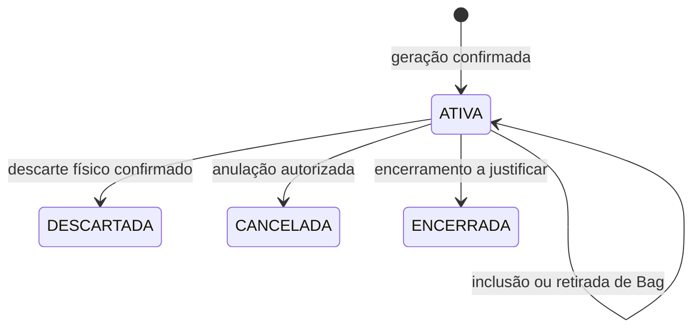

# Ciclo de vida da embalagem

## 1. Situação

- **Situação:** definição inicial para revisão etapa por etapa; ainda não implantada.
- **Base confirmada:** modelo de dados v1.7 e regras vigentes até DT-040; os detalhes propostos na DT-024 permanecem sujeitos à revisão.
- **Objetivo:** definir eventos, estados, transições, efeitos no saldo individual e vínculos com documentos, Bags e estoque consolidado.

## 2. Identidade e dimensões independentes

Cada embalagem possui uma identidade permanente em `contr_emb_etiqueta`. A etiqueta é a identificação física dessa embalagem: pode ser reimpressa quantas vezes forem necessárias, sempre com o mesmo código, sem criar outra embalagem ou novo movimento. Seu estado corrente fica em `contr_emb_etiqueta` e somente muda por fatos imutáveis de `contr_emb_movto` ligados a `contr_emb_evento`.

O ciclo não será representado por uma única situação que tente explicar tudo. Quatro dimensões permanecem separadas:

| Dimensão | Estrutura/campo | O que responde |
|---|---|---|
| Situação do ciclo | `contr_emb_etiqueta.situacao` | A identidade está ativa, cancelada, encerrada ou descartada? |
| Posição física | estabelecimento, depósito, localização, posse e `tipo-local` em `contr_emb_etiqueta` | Onde está e quem está com a embalagem agora? |
| Vínculo com Bag | `contr_emb_etiqueta.id-bag` | Em qual ocorrência de Bag ela está, se houver? |
| Quantidade | `qtidade-atu`, unidade e capacidade em `contr_emb_etiqueta` | Quanto existe atualmente na embalagem e qual sua capacidade congelada? |

Por exemplo, `TRANSITO` é posição física, não situação final; estar em uma Bag é vínculo logístico, não quantidade nem tipo de embalagem.

## 3. Regras confirmadas para toda a vida

E12/DT-098: entrada rastreada de empréstimo recebe as mesmas identidades TERCEIRO→ESTAB do recebedor, conservando 10 LT ou o conteúdo inteiro selecionado, com evento RECEBIMENTO_EMPRESTIMO e movimento ENTRADA_EMPRESTIMO. Posse física passa ao emitente do recebedor; o documento/evento conserva o vínculo ao credor e à remessa. Reversão restaura exatamente o snapshot anterior, contraparte incluída; nova atualização forma outro ciclo. Devolução parte dessa entrada e usa FT4012; saída ESTAB→TRANSITO registra SAIDA_RETORNO_TERCEIROS, com inverso e histórico, sem presumir chegada no credor. Preparado para TESTE, ainda sem compilação/execução.

E11/DT-097, 02/10: remessa de terceiros tipo 3 preparada para confirmar ESTAB→TERCEIRO com conteúdo/situação conservados e contraparte da nota; saída marca operação EXECUTADA, desatualização restaura snapshot e SOLICITADA, reatualização gera ciclo novo. EXECUTADA não quita empréstimo. Entrada no destino e retorno exigem seus eventos próprios e mesmas identidades; ainda não implementados/aprovados nesta entrega. Comparar saldo-terc padrão somente por consulta.

Complemento E10/DT-096, 02/10/2026: devolução de compra de embalagens inteiras segue o ciclo de saída/compensação já utilizado: atualização muda ESTAB para TRANSITO, preserva quantidade/situação, registra contraparte e movimento SAIDA_DEVOLUCAO_COMPRA; desatualização restaura snapshot do movimento original e reatualização cria fato novo. Não encerra identidade nem comprova chegada física ao fornecedor. A posição distingue disponibilidade interna do conteúdo físico. Saldo-terc é somente consultado nos ensaios para observar efeito padrão, sem escrita customizada. Implementação preparada para TESTE, sem aprovação de execução deste ciclo.

- O controle começa na entrada de compra de fornecedores com natureza `1101IS`, para itens ativos na parametrização. Essa entrada origina identidade, saldo individual e primeiro movimento; transferências posteriores preservam a identidade existente (DT-027).
- A identidade da etiqueta não é apagada nem reaproveitada.
- Item, tipo, lote, validade, unidade, capacidade e quantidade inicial ficam congelados após a criação.
- A fronteira do controle de estoque é estabelecimento + item + lote + validade.
- O saldo atual só muda junto com um movimento confirmado na mesma transação.
- Transferência pode alterar posição sem alterar o conteúdo físico da embalagem.
- Remessa confirmada para armazenagem em terceiro altera a posição/custódia da embalagem de `ESTAB` para `TERCEIRO`, preservando identidade e quantidade; o retorno confirmado aplica o caminho inverso somente às etiquetas e quantidades vinculadas à origem.
- O saldo consolidado de terceiros é controlado pelo padrão Datasul. O específico registra a correspondência individual do fato confirmado e nunca lança o mesmo movimento novamente no ERP.
- Correção não reescreve movimento confirmado; cria evento e movimento compensatórios.
- `saldo-estoq` continua como autoridade do saldo consolidado do Datasul.
- A Bag de descarte restringe somente `cod-tipo`. Pode conter itens, lotes, validades e capacidades diferentes do mesmo tipo.
- `cod-tipo` é a chave manual curta do tipo/variante: após normalização aceita 2–3 letras e/ou números, como `PL`, `PL1`, `PL2`, `001` e `002`. Não existe sigla separada e a capacidade continua em campo próprio.

## 4. Situações iniciais propostas

| Situação | Significado proposto | Observação |
|---|---|---|
| `ATIVA` | Identidade válida e apta a participar dos fluxos permitidos. | Localização, trânsito e Bag são consultados em dimensões próprias. |
| `CANCELADA` | Identidade criada indevidamente e anulada por evento autorizado. | Estado final; exige justificativa e não apaga histórico. |
| `DESCARTADA` | Embalagem cujo descarte físico foi confirmado. | Estado final. O momento exato dentro do ciclo da Bag está pendente. |
| `ENCERRADA` | Ciclo finalizado por motivo diferente de cancelamento ou descarte. | Necessidade e casos de uso ainda precisam ser comprovados. |

## 5. Eventos do ciclo a detalhar

A tabela abaixo é a sequência inicial. A cobertura ampliada, incluindo devolução parcial por origem e inversos dos movimentos fiscais/operacionais, está em [Devoluções e reversões, seção 4](../referencias/padrao-datasul/DEVOLUCOES_E_REVERSOES.md). Ela complementa as matrizes da DT-031, separando quantidade, posição, vínculo, pendência física/fiscal e fatos sem movimento.

| Ordem | Evento/caso de uso | Efeito principal esperado | Estado da definição |
|---:|---|---|---|
| 1 | Geração da etiqueta | Cria identidade, saldo inicial e primeiro movimento a partir do evento/item confirmado. | Detalhamento proposto na seção 7. |
| 2 | Saída entre estabelecimentos | Retira da posição disponível do emissor e coloca em trânsito, rateando o item fiscal. | Regra macro confirmada; transição detalhada pendente. |
| 3 | Recebimento no destino | Confirma a entrada das mesmas etiquetas no estabelecimento recebedor. | Regra macro confirmada; divergências pendentes. |
| 4 | Remessa para armazenagem em terceiro | Retira da disponibilidade interna e muda a custódia das mesmas etiquetas para `TERCEIRO`, acompanhando o saldo padrão de terceiros. | Regra funcional confirmada; natureza, produtor e chave do movimento pendentes. |
| 5 | Retorno de armazenagem | Baixa total ou parcialmente a origem em terceiro e restabelece a posição interna das mesmas etiquetas. | Regra funcional confirmada; seleção, confirmação e posição de destino pendentes. |
| 6 | Inclusão em Bag de descarte | Vincula a etiqueta à Bag compatível por `cod-tipo` e registra movimento sem inferir capacidade pelo código. | Compatibilidade confirmada; efeito na situação pendente. |
| 7 | Retirada de Bag | Remove o vínculo mediante evento autorizado e justificativa. | Procedure proposta; permissões pendentes. |
| 8 | Descarte confirmado | Marca a embalagem como descartada e preserva Bag, evento e histórico que sustentam o fato. | Momento e documento comprobatório pendentes. |
| 9 | Cancelamento | Anula identidade inválida sem apagar fatos. | Critérios pendentes. |
| 10 | Compensação | Corrige fato anterior com movimento inverso/rastreável. | Mecanismo estrutural definido; regras por evento pendentes. |

## 6. Fluxo inicial proposto

O diagrama não trata `TRANSITO` nem `EM_BAG` como situações porque esses dados pertencem à posição e ao vínculo atuais. As setas representam somente a situação do ciclo.

## 7. Fase atual — nascimento da embalagem e geração da etiqueta

**Situação:** detalhamento proposto para revisão (DT-024), apoiado nas regras já confirmadas. Não representa implementação nem aprovação das pendências abaixo.

### 7.1 Qual entrada cria uma identidade

O responsável técnico confirmou a natureza `1101IS` para a entrada de compra de fornecedores (DT-027). A atualização confirmada no recebimento é o gatilho técnico já definido. Além da parametrização ativa do item, a geração exige o enquadramento nessa operação. A EPC legada, linha 118, exclui `1101IS` do bloco de realocação entre estabelecimentos e terceiros porque o fluxo de compra era realizado no Fluig, conforme esclarecimento do responsável técnico. No novo fluxo, a geração acompanha o recebimento confirmado no Datasul; não depende da antiga criação fiscal pelo Fluig.

| Entrada | Tratamento | Situação da regra |
|---|---|---|
| Entrada de compra de fornecedor com natureza `1101IS` | Gerar identidades pelas quantidades efetivamente recebidas e normalizadas, conforme parametrização ativa. | Regra e código confirmados (DT-027). |
| Transferência entre estabelecimentos com etiquetas na origem | Receber as mesmas etiquetas, conservando identidade, tipo, capacidade e história. Não dividir novamente pela capacidade do cadastro do destino para recriá-las. | Regra macro já confirmada. |
| Retorno, devolução ou empréstimo | Identificar origem e etiquetas anteriores antes de decidir o efeito. | Detalhamento por operação pendente. |
| Item sem parametrização ativa, em entrada destinada à geração | Não gerar; registrar motivo quando a linha integrar o evento. | Participação definida pela parametrização do projeto. |
| Origem ou classificação ambígua | Impedir a geração automática e apresentar a pendência. | Proteção proposta. |

Falta de etiqueta na transferência não autoriza tratá-la como compra nem criar outra identidade. Parametrização inativa também não apaga nem torna inexistentes as etiquetas já controladas. Carga inicial e embalagens legadas pertencem ao plano de transição.

### 7.1.1 Convivência no corte

Ao ativar um item, a carga de corte registra como `PRE_SALDO` cada quantidade anterior agregada por estabelecimento, depósito/localização, item, lote e validade. O código `PRE-...` é técnico e não representa etiqueta física. Novos recebimentos criam somente `EMBALAGEM`, mesmo enquanto existir PRE do restante.

Sem inventário, o PRE permanece fora do fluxo específico. A movimentação ocorre somente no estoque consolidado, e a interface o apresenta como uma combinação que já existia antes do controle, sem permitir seleção como etiqueta, Bag ou movimento individual. O PRE não informa quantas embalagens existiam nem reconstrói o que ocorreu antes do corte. Para saná-lo, o cliente precisa inventariar. Nesse inventário, um único evento idempotente reduz o PRE e cria as embalagens reais com `id-pre-origem`. A soma das quantidades iniciais das embalagens precisa ser exatamente igual à redução do PRE. A operação inteira confirma ou falha em conjunto.

Rateio parcial mantém o PRE como origem do restante não individualizado; rateio total o encerra em zero. Embalagem criada do inventário recebe a quantidade física apurada, limitada por sua capacidade, conserva permanentemente a assinatura PRE em `id-pre-origem` e segue daí em diante o mesmo ciclo das demais. PRE não pode entrar em Bag, ser impresso, receber movimento específico ou ser confundido com contagem de embalagens.

### 7.2 Fluxo proposto

1. Receber a identificação estável da atualização fiscal e comprovar sua confirmação no Datasul. XML recebido, nota importada ou tela aberta não bastam para gerar.
2. Reconhecer a operação real e encaminhar para geração ou para recebimento de identidades existentes. Não inferir natureza fiscal pelo nome de programa ou somente pelo emitente.
3. Localizar o evento pela identidade da ocorrência e conferir seu conteúdo. Repetição concluída devolve o mesmo resultado antes de qualquer novo cálculo.
4. Resolver cada linha e ocorrência de lote/validade, unidade, quantidade efetiva, estabelecimento e posição de recebimento. Consultar e validar a parametrização aplicável à geração.
5. Congelar no item do evento quantidade, conversão, parâmetro/versão, tipo, capacidade, número de etiquetas e resíduo. Alterações cadastrais posteriores não recalculam eventos concluídos.
6. Na mesma transação local, criar cada identidade, seu saldo e primeiro movimento, vincular todos ao evento/item e concluir o resultado. A proposta é validar todos os itens participantes antes de confirmar o conjunto; erro em item participante não vira item ignorado.
7. Disponibilizar consulta e impressão somente dos registros confirmados. Falha de impressão não desfaz o recebimento nem gera novas identidades.

A captura durável do evento, a fronteira da transação ERP e a política para parâmetro alterado entre atualização fiscal e primeiro processamento precisam ser confirmadas. O fonte legado `epc-re1005rp.p` observa `fim-atualizacao`, mas seu nome não comprova execução após commit nem entrega garantida. Não transportar para o novo fluxo seus movimentos por referência ou suas tabelas específicas antigas.

### 7.3 Cálculo das etiquetas completas

Para cada ocorrência de linha/item/lote/validade, na unidade de estoque validada:

`qtd-etiquetas = parte inteira de (quantidade / capacidade-emb)`

`qt-residuo = quantidade - (qtd-etiquetas × capacidade-emb)`

| Quantidade recebida | Capacidade | Etiquetas | Quantidade individual total | Resíduo |
|---:|---:|---:|---:|---:|
| 200 L | 20 L | 10 | 200 L | 0 L |
| 105 L | 20 L | 5 | 100 L | 5 L |
| 10 L | 20 L | 0 | 0 L | 10 L |

O resíduo fica registrado no item do evento, continua compondo o saldo consolidado real e não gera etiqueta parcial nem consumo fictício. Não acumular resíduos entre documentos sem regra aprovada. A conciliação da geração é quantidade representada pelas novas etiquetas + resíduo = quantidade normalizada recebida; não compara automaticamente as etiquetas novas com todo o saldo anterior do estabelecimento.

Lotes ou validades diferentes têm cálculos separados, mesmo para o mesmo item. A soma dos lotes precisa corresponder à linha fiscal, sem repetir a quantidade total em cada lote. Repetição do mesmo item/lote/validade em linhas distintas preserva as linhas; eventual reunião das quantidades para cálculo ainda precisa ser definida. Conversão desconhecida, capacidade não positiva ou precisão incompatível exige erro explícito, sem arredondamento silencioso.

### 7.4 Registros criados

| Estrutura | Conteúdo da criação proposta |
|---|---|
| `contr_emb_evento` | Ocorrência confirmada, identidade do documento/ciclo e resultado do processamento. |
| `contr_emb_evento_item` | Linha/lote, quantidade normalizada e memória do cálculo, inclusive quando gera zero etiquetas. |
| `contr_emb_etiqueta` | Uma identidade global por embalagem completa, com origem no evento/item e sequência única dentro do evento inteiro; item/lote/validade recebidos; tipo/capacidade/unidade congelados; `qtidade-ini = qtidade-atu = capacidade-emb`; estabelecimento recebedor; depósito/localização reais quando aplicáveis; proposta de situação `ATIVA`, posição `ESTAB` e ausência de vínculo com Bag. |
| `contr_emb_movto` | Um primeiro fato por etiqueta, ligado ao evento/item; quantidade envolvida e final iguais à capacidade, quantidade anterior zero; sem movimento antecedente. `contr_emb_etiqueta.id-movto-ult` aponta para esse fato. |

Na geração, zero anterior significa ausência de quantidade individual registrada antes do nascimento; não representa embalagem vazia previamente existente. Não há estado nem posição individual anterior. Por isso, no primeiro movimento, `id-movto-ant`, `situacao-ant`, `cod-estabel-orig` e `tipo-local-orig` ficam ausentes e `qtidade-ant` é zero. Nos movimentos seguintes, estado, posição e movimento anteriores são obrigatórios e devem coincidir com a projeção corrente. Não preencher origem fictícia.

Não fixar depósito `INS`, localização, estabelecimento ou usuário no código. O movimento específico explica a individualização e não lança outra entrada no estoque padrão: o recebimento fiscal já produziu seu efeito consolidado.

Sem localização interna informada, a projeção `contr_emb_etiqueta.cod-localiz` fica vazia (`""`), acompanhando `saldo-estoq`. Isso vale no nascimento e nas movimentações seguintes; registros antigos não são regravados automaticamente.

### 7.5 Repetição, falha e impressão

- Mesma ocorrência e mesmo conteúdo: mesmo resultado e mesmas etiquetas, inclusive se houve perda da resposta.
- Mesma chave com conteúdo diferente: conflito; nova tentativa técnica não cria outro ciclo fiscal.
- Dois executores concorrentes: somente um confirma os efeitos, usando as garantias comuns de evento e transação do modelo.
- Falha antes da confirmação local: desfazer identidades, saldos e movimentos dessa tentativa; preservar o diagnóstico e permitir repetição controlada. Lacunas nas sequências são aceitas.
- Falha depois de confirmado, ao responder ou imprimir: recuperar o resultado existente. Reimpressão usa o mesmo código e não muda quantidade ou situação da embalagem.
- Código público segue a identidade única já prevista, sem incorporar item, lote, tipo ou capacidade. Layout, simbologia, impressora e eventual auditoria da impressão serão definidos separadamente.
- Cancelamento ou desatualização fiscal não apaga etiquetas. Localizar os efeitos e dependências; compensação e eventual novo ciclo dependem da regra de negócio ainda aberta.

No recorte inicial da compra `1101IS`, uma embalagem que não saiu do movimento de nascimento pode ser compensada após o RE0402: evento próprio relacionado ao gerador, movimento individual com justificativa identificando documento desatualizado, projeção `CANCELADA` e quantidade zero. A identidade, a origem e o nascimento permanecem. Bag, movimento posterior ou ciclo ambíguo bloqueiam a reversão automática; reatualização ainda não está coberta. Esse recorte está preparado em fonte, pendente de compilação e prova do EPC em TESTE.

Na transferência integral 5557/1557, a entrada atualizada leva cada etiqueta selecionada de `TRANSITO` na origem para `ESTAB` no destino. A desatualização efetiva dessa entrada registra outro evento e outro movimento por etiqueta, retornando a `TRANSITO` na origem, sem zerar quantidade, cancelar identidade ou apagar a chegada. Reatualizar a mesma entrada registra nova chegada e novo movimento. O último movimento deve ser exatamente o da chegada ativa para admitir a compensação; ciclos ou dependências ambíguos bloqueiam. Esta extensão DT-092 está preparada em fonte, ainda sem SAVE ou execução integrada dos ciclos.

O primeiro par entrada/reversão dessa transferência foi comprovado em TESTE para as etiquetas 101/103: entrada 1557 no evento 193, seguida de desatualização no evento 195/ciclo 2 e movimentos 125/127, com retorno a `TRANSITO/10904`, 10 LT, `ATIVA`. A nova atualização da mesma entrada, que fechará o ciclo 3, ainda não foi executada nesta evidência.

### 7.6 Cenários de aceite do futuro desenvolvimento

| Cenário | Resultado a conferir |
|---|---|
| Compra confirmada de 200 L, capacidade 20 L | 10 identidades, 10 saldos de 20 L e 10 movimentos iniciais, sem duplicar entrada ERP. |
| Mesmo item em dois lotes | Memórias de cálculo e etiquetas separadas, mantendo respectivas validades. |
| Quantidade inferior à capacidade | Evento/item concluído com zero etiquetas e resíduo conhecido. |
| Repetição após mudança da capacidade cadastrada | Resultado original preservado, sem recalcular evento concluído. |
| Erro de configuração em uma linha participante | Diagnóstico explícito e nenhum efeito parcial do conjunto proposto. |
| Recebimento de transferência | Mesmas identidades da saída; geração não é chamada. |
| Impressão repetida ou resposta perdida | Nenhuma etiqueta, saldo ou movimento adicional. |
| ERP desfaz a atualização antes de confirmar | Nenhuma etiqueta definitiva desse recebimento. |

São critérios para implementação/homologação; não foram executados em ABL ou banco nesta etapa.

### 7.7 Pontos a fechar nesta fase

1. Definir como configurar a natureza geradora `1101IS`, cujo código e finalidade de compra já estão confirmados. Mapear separadamente entradas de etiquetas existentes.
2. Tratamento de quantidades repetidas do mesmo item/lote/validade em linhas distintas, localização e eventuais repartições entre depósitos.
3. Momento de congelamento do parâmetro quando houver atraso/reprocessamento anterior à primeira conclusão.
4. Confirmação e entrega durável do evento, identidade do ciclo e cancelamento/desatualização.
5. Ajuste pontual do estado anterior do primeiro movimento e limites de volume por transação.
6. Layout e operação de impressão/reimpressão.

Depois serão detalhadas saída, trânsito, entrada, Bag de descarte e estados finais.

## 8. Abrangência das próximas fases

Conforme DT-028, a classificação existente nos fontes de recebimento é referência, não limite do ciclo novo. Além das transferências entre estabelecimentos e operações com terceiros, serão detalhados devoluções, empréstimos, cancelamento de notas e renovação de empréstimos.

Cada caso precisa explicitar o documento/operação de origem, as etiquetas envolvidas, os movimentos do estoque padrão e o tratamento de repetição ou compensação. Em renovação, refletir cada movimentação confirmada do saldo consolidado nas etiquetas vinculadas, sem criar novas identidades; ausência de deslocamento material não exclui o movimento (DT-034). Em cancelamento, considerar os movimentos posteriores antes de definir a compensação. Os contratos e fluxos detalhados permanecem pendentes de revisão conjunta.

### 8.1 Custódia e saldo de terceiros

Na armazenagem em terceiro, a saída confirmada conserva `qtidade-atu` e muda a projeção de posição/posse da embalagem: origem interna no estabelecimento remetente e destino `TERCEIRO`, com a contraparte e a chave do movimento ERP comprovadas. A quantidade do movimento informa quanto foi envolvido; a variação do conteúdo individual pode permanecer zero. A pendência da operação nasce somente após o efeito padrão confirmado.

O retorno deve partir do documento e da linha de origem, respeitar saldo disponível e alocado do padrão e selecionar as etiquetas efetivamente devolvidas. Retorno parcial mantém em `TERCEIRO` as demais embalagens ou quantidades ainda pendentes. A confirmação cria outro fato imutável, baixa a linha de origem na dimensão aplicável e atualiza a projeção das devolvidas para a posição interna real. Cancelamento ou desatualização compensa apenas os movimentos realmente revertidos, sem apagar a cadeia.

O modelo v1.7 já contém os dados necessários em `contr_emb_etiqueta`, `contr_emb_movto`, `contr_emb_oper` e `contr_emb_oper_item`; não foi identificada necessidade de tabela adicional de saldo de terceiros. Falta comprovar no ambiente a natureza, o produtor do movimento, a chave canônica, o documento/linha de origem, a posição de retorno e a aplicação do mesmo comportamento a cada modalidade de empréstimo entre empresas.

## 9. Execução no Fluig e no Datasul

**DT-102/E13, 05/10 — chegada do retorno preparada:** a entrada no credor usa a nota de retorno e conserva separadamente a remessa original. Vinculo documental aponta ao retorno, evento RECEBIMENTO_RETORNO_EMPRESTIMO aponta a SAIDA_ESTOQUE ativa e cada ENTRADA_RETORNO_EMPRESTIMO aponta seu movimento de saida. Mesmas identidades passam TRANSITO/devolvedor -> ESTAB/credor com rateio real e posse do credor; quantidade e situacao conservadas. RE0402 restaura snapshot TRANSITO/devolvedor, sem apagar chegada, e nova atualizacao cria ciclo. Fato posterior incompatível ou outra chegada ativa bloqueiam. Sem escrita em estoque/terceiros padrao; confirmacao da baixa consolidada de terceiros depende do ensaio nativo. Ainda sem SAVE/aceite desse ramo. Natureza complementar permanece detalhe para analise final, sem causa presumida.

**Recebimentos DT-100, 04/10 — código preparado, sem aceite nativo:** a entrada mantém associação documental à saída/operação em `VINCULO_ENTRADA_SAIDA`. A chegada liga o ciclo físico ativo e cada movimento liga sua saída individual e seu predecessor real. O último movimento valida continuidade; não escolhe a nota. Após reversão comprovada da entrada A, uma entrada B com outra numeração pode receber a mesma origem se identificada por referência documental ou associação dirigida confiável. A reversão de A continua no histórico; chegada ativa em A, origem ambígua ou estado posterior incompatível bloqueia B. Vínculo e efeitos específicos confirmam atomicamente. Quantidade/situação conservadas; posição/posse seguem o recebimento. Saldo de terceiros do remetente é controlado pelo padrão e não é baixado apenas pela chegada no destinatário. Parcialidade, cancelamento fiscal e ANFe real não estão homologados. Roteiro `docs/entregas/E12_VINCULO_RECEBIMENTOS_DT100.md`; registros anteriores abaixo podem estar desatualizados.

No E04, a mesma nota de saída pode passar por novo ciclo de atualização após desatualização, sem recriar a etiqueta nem apagar os fatos anteriores. O elo documental com o WT e a operação identifica as mesmas embalagens; cada atualização confirmada gera saída individual nova e cada desatualização compensa somente a saída ainda ativa. A posição alterna entre `ESTAB` e `TRANSITO`; situação e quantidade permanecem dimensões independentes. A primeira revisão de múltiplos ciclos sob a mesma nota ainda depende de SAVE e ensaio integrado em TESTE (DT-089).

No primeiro recorte DT-090/091 da entrada correspondente à saída 5557, a nota 1557 confirmada no RE1001 deve recuperar a única saída ativa e suas etiquetas; o movimento de chegada leva essas mesmas identidades de `TRANSITO` para `ESTAB` no estabelecimento da entrada e no depósito/localização do `rat-lote` associado à linha. Quantidade e situação permanecem independentes da posição. O recorte é integral, com uma linha e um rateio; parcialidade, múltiplos rateios/documentos e reversão dessa chegada ainda não estão cobertos. Correção do rateio preparada, ainda sem novo SAVE ou ensaio integrado.

O ensaio manual de 30/09 confirmou essa transição para 101/103: evento 193, dois movimentos e estado final ativo em `10913/INS`, sem criar novas etiquetas. ANFE end-to-end e compensação da entrada continuam fora da cobertura validada.

Conforme DT-031, a manutenção de etiquetas no Fluig solicita a NF de saída e deve ser preservada ao máximo. A execução fiscal ocorre no Datasul, que também pode iniciar saídas diretamente pelo padrão. Ambos os caminhos devem conservar as mesmas identidades e toda a cadeia documental; recebimentos e tratamentos fiscais permanecem no Datasul/ANFE.

O detalhamento por operação e marco está em [MATRIZ_EVENTOS_EXECUCAO.md](../referencias/padrao-datasul/MATRIZ_EVENTOS_EXECUCAO.md). Distinguir documento efetivado, situação eletrônica, estoque atualizado/desatualizado e efeito específico. A natureza pode atualizar o estoque automaticamente no cálculo; a captura não pode depender apenas da execução posterior do FT2100.

A proposta mantém seleção anterior à emissão, vínculo ao documento único criado em cada execução do Fluig e processamento comum de movimentos. Na manutenção de etiquetas, o usuário seleciona embalagens e natureza; quando a natureza exigir devolução, o fluxo obtém documento de origem, emitente e itens elegíveis antes de chamar a BO padrão. Solicitação não constitui baixa; cancelamento sem baixa anterior não gera entrada por si só. Renovação acompanha o estoque padrão: cada entrada/saída confirmada do consolidado deve ser refletida nas etiquetas vinculadas, inclusive operações fiscais/simbólicas e etapas cujo efeito líquido seja zero (DT-034). As regras de seleção no padrão, confirmação durável e compensação de cadeias com eventos posteriores continuam pendentes. Preservar situação, posição, vínculo com Bag e quantidade como dimensões distintas, sem usar essa separação para ocultar movimentos do ERP.

## 10. Devolução parcial e reversão da origem

Conforme DT-033, o fluxo seleciona documento original, itens e quantidades, integral ou parcialmente. O rateio precisa identificar as etiquetas daquela execução antecedente, sem usar somente a nota de nascimento ou substituir o histórico pelo último documento. A disponibilidade deve considerar tanto o padrão quanto as etiquetas elegíveis na posição/posse atual.

Uma devolução atende somente sua parcela da origem. Revertê-la compensa essa baixa e seus efeitos confirmados, mantendo as outras devoluções válidas. A baixa física e a fiscal continuam separadas, conforme o modelo corrente. O detalhamento e os cenários estão no complemento de devoluções e reversões; ainda não são contratos ABL/REST homologados.

## DT-103/E14 — retorno de armazenagem preparado (05/10/2026)
Reutiliza as assinaturas processarEntradaEmprestimo/reverterEntradaEmprestimo e hooks instalados. NFE/terceiros tipo5 sem retorno interno rastreado resolve RETORNO_ARMAZENAGEM -> REMESSA_TERCEIROS da propria fazenda para o emitente da entrada, por referencia completa de todos os itens. VINCULO_ENTRADA_SAIDA aponta remessa, RECEBIMENTO_RETORNO_TERCEIROS aponta saida ativa, ENTRADA_RETORNO_TERCEIROS aponta movimentos; TERCEIRO -> ESTAB e inverso por snapshot. Guardas comuns incorporam esse tipo de chegada. registrarSelecaoRemessaAposWt aceita destino vazio para emitente externo cadastrado; FT2100 permite esse caso somente no ramo REMESSA_TERCEIROS. Transferencia continua exigindo destino; demais fluxos preservados. Sem tabelas/campos/REST novos. Preparado sem SAVE/ensaio; compiladorE14 sete fontes, roteiro docs/entregas/E14_ARMAZENAGEM_TERCEIRO.md. Cenários: sucesso integral/repeticao/compensacao previstos; sem origem/ambiguo/quantidade ou estado divergente bloqueados. Integracao real/parcelas ainda pendentes.

## E15/DT-106 — encerramento automatico preparado, 05/10/2026
Implementado fontes/progress/contr-emb-cancelamento.p, procedure concluirCancelamentoNota(ROWID nota, usuario; aplicavel, sucesso, repeticao, id-operacao, erro, mensagem). Confere identidade/documento/carimbo CEWT1, cancelamento nativo, estoque desconfirmado e compensacao unica de cada saida. Sob lock da operacao, encerra CANCELADA apenas quando todas as notas associadas estiverem canceladas e reconciliadas. Primeira conclusao atualiza autor/data/versao; repeticao nao altera versao. Nota sem vinculo especifico devolve nao aplicavel/sucesso. Nenhuma escrita em estoque, etiquetas, eventos ou movimentos; preserva historico. Divergencia, lock ou efeito ativo impedem conclusao.
UPC-BODI135CANCEL-DIAGNOSTICO-TESTE agora tambem e funcional: AFTERINVOICECANCELLATION exige transacao e chama o servico; FIM_CANCELANOTAFISCAL permanece observacao. Erro funcional propagado, nunca suprimido pelo log. Nome instalado mantido para evitar mudar cadastro. Nao e pos-commit. Sem nova API/schema. Compensacao continua exclusivamente no FT2100.
Executor parametrizado testes/e15/concluir-operacao-cancelada.p realiza fechamento, repeticao, estabilidade de versao/quantidade de movimentos e rollback quando PERSISTIR=no. Uso excepcional para op23 ja cancelada; fluxo futuro pelo hook. SAVE/rollback/propagacao de erro e aceite nativo ainda pendentes. Cenários sem baixa, varias notas, dependencias posteriores e anulacao continuam sem homologacao; nao afirmar garantia geral.
